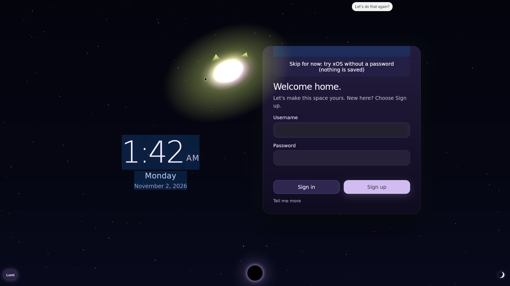

<p align="center"></p>

# xOS · public beta

**xOS is its own operating system, on its own compiled kernel, with Lumi, a local AI that runs on your machine.**
Try it live from a USB stick. Install only if you want.

[**Download the g37 beta**](https://github.com/godly-juice/xos/releases/tag/g37-public-beta.1) · [Why xOS exists](https://about.xseed.ing/) · [Report an issue](https://github.com/godly-juice/xos/issues)

**The g37 beta is free, on purpose: it's there to shake the bugs out. g38 will be paid.** An optional $1/month Supporter option is planned; payments are not open.

## Why

I wanted to know what my own computer is doing: every process explained, every byte leaving it accounted for, real off buttons. xOS is built around that rule.

## What you get

- Boots live from a 16 GB USB stick (**Try xOS**). Installing is a separate, explicit choice.
- Lumi, a local AI companion. The standard build ships Phi-4-mini and runs it on your hardware: no account, no cloud, no API key.
- A fresh identity on first boot: no personal memory, no device enrollment, developer background work disabled.
- The g37 add-on source, a package inventory, retained notices, and a `VALIDATION.md` that says which checks were completed and which were not.

Needs an x86-64 PC with 8 GB RAM, or a disposable VM. The image is 5.6 GB, in four parts with checksums.

## Try xOS

[Download g37-public-beta.1](https://github.com/godly-juice/xos/releases/tag/g37-public-beta.1)

The release contains a split raw disk image, a Windows downloader, checksums, notices, a source archive, and a package inventory. On Windows, download and inspect `Download-xOS.ps1`, then run:

```powershell
./Download-xOS.ps1 -Directory ./xos-beta
```

It downloads, verifies, and joins the parts into `xos-g37-public.img`. It does not flash a USB drive or install xOS. See [BETA.md](BETA.md) for manual assembly and testing instructions.

Use an x86-64 PC with at least 8 GB RAM, or a disposable VM. A spare USB drive should be at least 16 GB. Start with **Try xOS**; installation is a separate choice that can erase its selected target.

## What's included

| Item | Status |
| --- | --- |
| g37 desktop and local-model runtime | Public bootable beta |
| Phi-4-mini | Standard model assets; Microsoft MIT notice included |
| [g37 add-on source](src/g37/) and [shared shell theme](src/lumi/shell/layout.css) | Published source snapshot |
| [g38](docs/g38-plan.md) | Planned; not built or released |

The public image starts with a fresh account and machine identity. Personal memory, Canon databases and embeddings, private application/runtime data, hosted accounts, and existing device enrollment are excluded. Background work for the developer's machines and private failover connections are disabled. Services requiring your own backend or credentials need separate configuration.

Read the release's `VALIDATION.md` for the checks actually completed and the remaining limits. Beta availability is not a promise that every app or physical PC is supported.

## Free beta, optional support

Beta access is **$0**. The planned **$1/month Supporter** option has the same published software features as the free beta. **There is no active checkout or subscription.** Local AI uses your hardware; third-party APIs or hosted compute are separate. See [PRICING.md](PRICING.md).

## Who builds xOS

One founder directing an AI crew: **Lumi** (the AI inside xOS and the local models on the founder's machine), **ChatGPT (Codex)** (build and release engineering) and **Claude** (infrastructure and review). Who did what is in [CONTRIBUTORS.md](CONTRIBUTORS.md), and commits carry `Co-Authored-By:` lines.

## Source, notices, and feedback

This repository contains a focused g37 add-on snapshot, not a complete standalone OS builder. The bootable release also provides a source archive and package inventory. Existing component licenses and notices remain in effect; no blanket license for the complete distribution is added here. See [LICENSE-NOTICE.md](LICENSE-NOTICE.md).

[Report an issue](https://github.com/godly-juice/xos/issues) with the build ID, what happened, and a small redacted log or screenshot. Keep credentials and personal exports out of reports.
